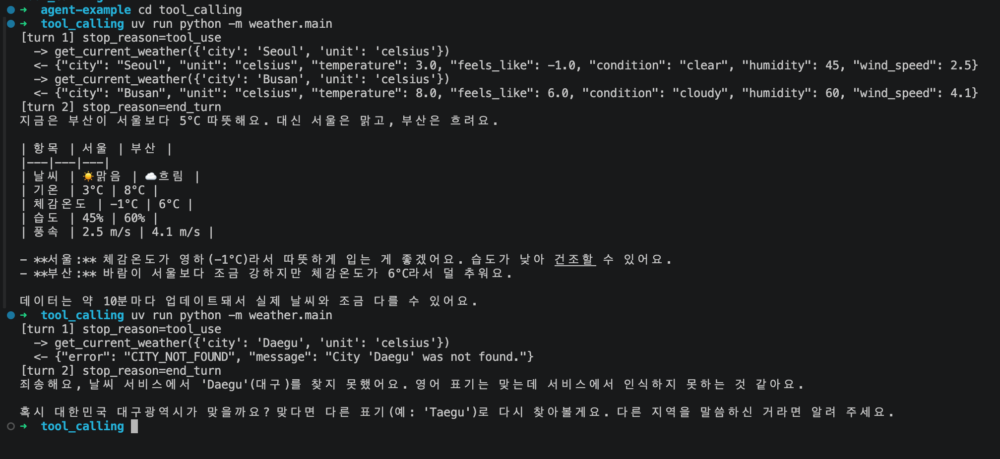

# agent-example

LLM 에이전트를 공부하면서 만든 예제 모음입니다.
주제마다 **독립된 uv 프로젝트**로 나누어, 각자 의존성과 가상환경을 따로 가집니다.

| 프로젝트 | 내용 |
|---|---|
| [`tool_calling/`](tool_calling) | Claude API로 tool calling(function calling)과 에이전트 루프 직접 구현 |

---

## tool_calling

Claude가 도구를 고르고 → 내 코드가 실행하고 → 결과를 돌려주는 흐름을 **SDK 헬퍼 없이 직접** 구현한 예제입니다.

### 구조

```
tool_calling/
├── pyproject.toml / uv.lock   # 의존성 (anthropic, python-dotenv)
├── .env.example               # 환경변수 템플릿
├── config.py                  # .env 로드, MODEL 설정
└── weather/
    ├── tools.py               # Claude에게 보여줄 도구 명세 (JSON schema)
    ├── handlers.py            # 실제로 실행되는 함수 + 이름→함수 매핑
    └── main.py                # 에이전트 루프
```

| 파일 | 역할 | 배우는 포인트 |
|---|---|---|
| `tools.py` | `name` / `description` / `input_schema` | 모델은 코드를 못 보고 **명세만 보고** 도구를 고른다 |
| `handlers.py` | 도구의 실제 구현 (가짜 데이터) | 실행은 **내 코드**가 한다. description의 계약을 그대로 지킨다 |
| `main.py` | 요청 → `tool_use` → 실행 → `tool_result` 반복 | 메시지 히스토리가 쌓이는 방식, 병렬 호출, 에러 전달 |

### 실행

```bash
cd tool_calling
cp .env.example .env        # ANTHROPIC_API_KEY 채우기
uv sync
uv run python -m weather.main
```

> `tool_calling/` 안에서 `-m weather.main` 형태로 실행해야 `config`, `weather`를 import할 수 있습니다.

### 실행 결과

**서울·부산 비교** - 도시 하나당 한 번씩 **병렬 호출**

```
[turn 1] stop_reason=tool_use
  -> get_current_weather({'city': 'Seoul', 'unit': 'celsius'})
  -> get_current_weather({'city': 'Busan', 'unit': 'celsius'})
[turn 2] stop_reason=end_turn
지금은 부산이 서울보다 5°C 따뜻해요. ...
```

**대구 (데이터에 없는 도시)** - `CITY_NOT_FOUND` + `is_error` → 다른 도시로 추측하지 않고 사용자에게 되물음

```
[turn 1] stop_reason=tool_use
  -> get_current_weather({'city': 'Daegu', 'unit': 'celsius'})
  <- {"error": "CITY_NOT_FOUND", "message": "City 'Daegu' was not found."}
[turn 2] stop_reason=end_turn
죄송해요, 날씨 서비스에서 'Daegu'(대구)를 찾지 못했어요. ...
```



### 배운 것

**tool description 작성법** - "도구 설명서(man page)"처럼, 짧게보다 정확하게

- 해야 할 것: 무엇을 하는지 / 언제 쓰고 언제 쓰지 않는지 / 무엇을 반환하는지 / 한계와 에러 / 파라미터별 설명
- 하지 말 것: `CRITICAL: MUST ALWAYS use` 같은 강한 지시, 예시 대화 넣기, 대화 방식 지시
- 스키마로 막을 수 없는 규칙(예: `"Seoul, Busan"` 같은 입력)은 description으로 알리고, **금지만 하지 말고 대안**을 준다
- 값이 정해진 파라미터는 `enum` + `strict: True`로 목록 밖의 값을 막는다

**에이전트 루프**

- `response.content`를 **통째로** assistant 메시지에 추가한다 (thinking 블록 등 포함)
- `tool_result`의 `tool_use_id`는 `tool_use` 블록의 `id`와 짝을 맞춘다
- 병렬 호출의 결과는 **한 user 메시지**에 모아서 보낸다
- 실패는 예외 대신 `is_error: True`로 모델에게 알린다
- `MAX_TURNS`로 무한 루프를 막는다

### 다음에 해볼 것

- [ ] `get_forecast` 추가 → 현재 날씨와 예보 도구의 경계 관찰
- [ ] description의 에러 대응 문장 제거 / `is_error` 끄기 → 모델 행동 비교
- [ ] 실제 날씨 API 연동
- [ ] SDK Tool Runner(`client.beta.messages.tool_runner`)와 수동 루프 비교

---

## 새 프로젝트 추가하기

```bash
mkdir evals && cd evals
uv init --bare --python 3.12   # pyproject.toml만 생성
uv add anthropic python-dotenv
```

`--bare` 없이 `uv init`을 하면 `README.md`, `.git` 등이 함께 생성되니 주의.
